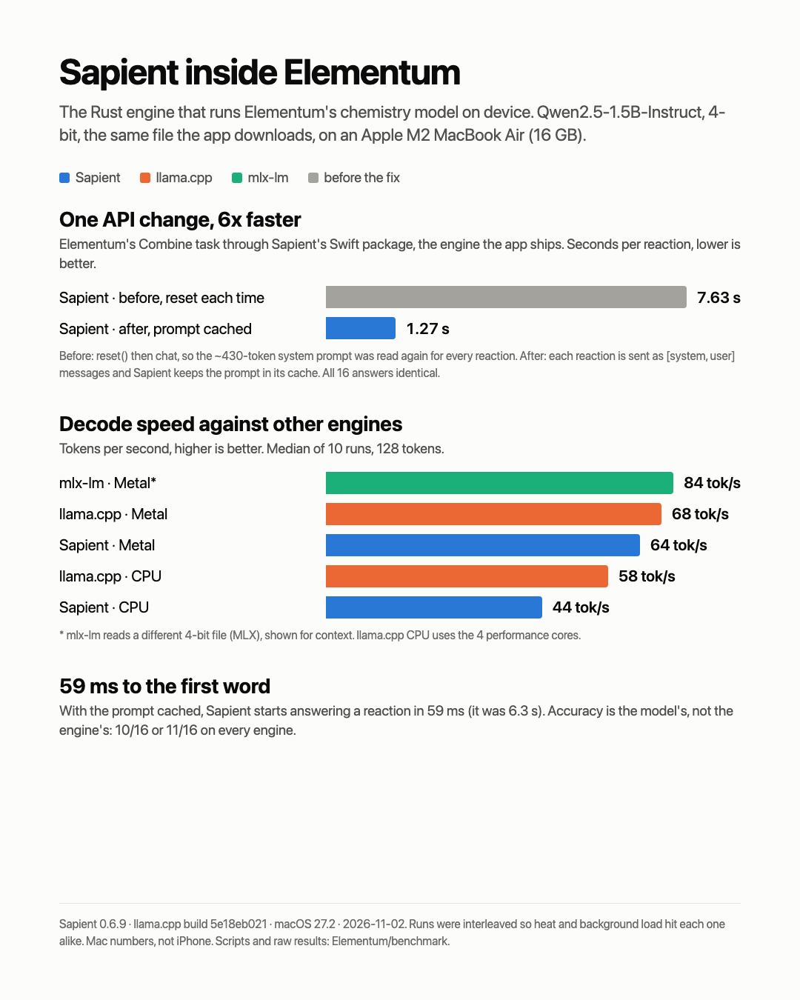

# Elementum benchmark: Sapient vs other engines

Measured on 2 November 2026 on an Apple M2 MacBook Air (16 GB, 4 performance cores, fanless), macOS 27.2.
Model: **Qwen2.5-1.5B-Instruct Q4_K_M**, the exact GGUF file Elementum downloads on phones with 6 GB of RAM or less
(1,117,320,736 bytes, SHA-256 `6a1a2eb6…`). Every engine that reads GGUF read this same file.

Engines: **Sapient 0.6.9** (the release Elementum's Swift package uses, `-metal` build), **llama.cpp** build 12047
(`5e18eb021`), and **mlx-lm** with `mlx-community/Qwen2.5-1.5B-Instruct-4bit` for context.

## 1. Raw decode speed

`run_engines.py`: 128 generated tokens, 5 runs per engine per round, 2 rounds interleaved across engines,
5 s pause between engines. Sapient via `sapient bench-llm` (greedy, warm-up excluded), llama.cpp via `llama-bench`
(`-p 32 -n 128`, 4 threads for CPU, `-ngl 99` for Metal), mlx-lm via `mlx_lm.generate` (first run discarded).

| Engine | Decode tok/s (median) | Range | First token | Peak memory |
|---|---:|---:|---:|---:|
| mlx-lm (MLX 4-bit, context) | 84.5 | 74.2–86.1 | not measured | 1.01 GB |
| llama.cpp Metal | 68.4 | 68.3–68.7 | not measured | not measured |
| Sapient Metal | 64.0 | 56.2–67.3 | 65 ms | 2.38 GB |
| llama.cpp CPU 4t | 57.5 | 53.0–59.4 | not measured | not measured |
| Sapient CPU | 44.0 | 40.0–44.8 | 256 ms | 1.52 GB |

Raw data: `results/engines-2026-11-02.json`.

## 2. Elementum's Combine task

`run_combine.py`: Elementum's own system prompt (read from `ReactionModel.swift`, about 430 tokens) and
`Reactants: ...` messages, greedy, max 150 tokens, as the app sends them. 16 reactions × 3 passes × 4 configs,
all servers running at once (`sapient serve`, `llama-server`), the order rotated for every reaction and a 2 s pause
between requests. Speed changed by under 5% from the first third of the run to the last, so heat did not skew it.
Every config gave identical replies on all three passes.

| Config | Time per reaction | First token | Decode tok/s | Correct |
|---|---:|---:|---:|---:|
| llama.cpp Metal | 0.73 s | 94 ms | 62.9 | 11/16 |
| llama.cpp Metal, no prompt cache | 1.32 s | 673 ms | 62.5 | 11/16 |
| Sapient CPU | 1.37 s | 233 ms | 33.9 | 10/16 |
| Sapient Metal | 1.71 s | 989 ms | 54.5 | 10/16 |

"Time per reaction" is the full reply, from sending the request to the last token. llama.cpp's server reuses the
shared system prompt between requests unless asked not to (`cache_prompt: false`), so the no-cache row is the
like-for-like comparison with Sapient on Metal.

### Answers, graded automatically

The grader checks that each element has the same atom count on both sides and that the products match the
expected answer; "no reaction" and invalid-input cases must follow the prompt's rules.

| Reactants | Expected | Sapient Metal | Sapient CPU | llama.cpp | llama.cpp no cache |
|---|---|---|---|---|---|
| Mg + O2 | MgO | correct | correct | correct | correct |
| Fe + O2 | Fe2O3 | correct | correct | correct | correct |
| CH4 + O2 | CO2 + H2O | correct | correct | correct | correct |
| Zn + HCl | ZnCl2 + H2 | unbalanced | correct | correct | correct |
| NaOH + HCl | NaCl + H2O | correct | correct | correct | correct |
| Na + H2O | NaOH + H2 | correct | correct | correct | correct |
| Cu + AgNO3 | Cu(NO3)2 + Ag | correct | correct | correct | correct |
| C + O2 | CO2 | wrong products | wrong products | wrong products | wrong products |
| N2 + H2 | NH3 | correct | correct | correct | correct |
| Al + O2 | Al2O3 | correct | correct | correct | correct |
| Ca + H2O | Ca(OH)2 + H2 | correct | correct | correct | correct |
| K + Cl2 | KCl | correct | unbalanced | correct | correct |
| 2 H2 + 2 O2 | H2O | unbalanced | unbalanced | unbalanced | unbalanced |
| Pt + HCl | none | invented a reaction | invented a reaction | invented a reaction | invented a reaction |
| Ne + O2 | none | invented a reaction | invented a reaction | invented a reaction | invented a reaction |
| Xq + O2 | invalid | wrong | wrong | wrong | wrong |

Sapient Metal's first lines, for reference:

- **Mg + O2**: `EQUATION: 2Mg + O2 → 2MgO`
- **Fe + O2**: `EQUATION: 4Fe + 3O2 → 2Fe2O3`
- **CH4 + O2**: `EQUATION: CH4 + 2O2 → CO2 + 2H2O`
- **Zn + HCl**: `EQUATION: 2Zn + 2HCl → 2ZnCl2 + H2`
- **NaOH + HCl**: `EQUATION: NaOH + HCl → NaCl + H2O`
- **Na + H2O**: `EQUATION: 2Na + 2H2O → 2NaOH + H2`
- **Cu + AgNO3**: `EQUATION: Cu + 2AgNO3 → Cu(NO3)2 + 2Ag`
- **C + O2**: `EQUATION: 2C + O2 → 2CO`
- **N2 + H2**: `EQUATION: N2 + 3H2 → 2NH3`
- **Al + O2**: `EQUATION: 4Al + 3O2 → 2Al2O3`
- **Ca + H2O**: `EQUATION: Ca + 2H2O → Ca(OH)2 + H2`
- **K + Cl2**: `EQUATION: 2K + Cl2 → 2KCl`
- **2 H2 + 2 O2**: `EQUATION: 2H2 + 2O2 → 2H2O`
- **Pt + HCl**: `EQUATION: Pt + 2HCl → PtCl2 + H2`
- **Ne + O2**: `EQUATION: 2Ne + O2 → 2NeO`
- **Xq + O2**: `EQUATION: 2Xq + O2 → 2XO`

Raw data: `results/combine-2026-11-02.json`.

## 3. The engine Elementum ships, through the Swift package

Parts 1 and 2 used Sapient's command-line `-metal` build, whose GPU engine is MLX. **The Swift package Elementum
uses is built differently**: its GPU engine is wgpu on Metal, alongside the CPU engine, and MLX isn't in it. So this
part runs the same 16 reactions × 3 passes through `sapient-swift` 0.6.9 itself (`swift/`), comparing the call
pattern Elementum used against one that keeps the system prompt cached. The two patterns were interleaved and each
had its own session.

With `auto`, Sapient timed the GPU and the CPU on this Mac for this model at first load and chose the CPU
(prompt: GPU 1170 ms vs CPU 615 ms; per token: GPU 46.5 ms vs CPU 24.9 ms), so both rows run on the CPU here.

| Backend | Call pattern | Time per reaction | First token | Decode tok/s | Correct |
|---|---|---:|---:|---:|---:|
| auto (cpu) | before: reset() + chat | 7.63 s | 6323 ms | 29.5 | 10/16 |
| auto (cpu) | after: [system, user] messages | 1.27 s | 59 ms | 32.3 | 10/16 |
| cpu (cpu) | before: reset() + chat | 8.32 s | 6851 ms | 27.1 | 10/16 |
| cpu (cpu) | after: [system, user] messages | 1.34 s | 56 ms | 31.1 | 10/16 |

Both patterns gave identical replies, word for word, on all 16 reactions, and every pass was deterministic.

**Why:** `LlmSession.reset()` clears the conversation *and* the cache (`pipeline.reset_cache()`), so calling it before
every reaction made Sapient read the ~430-token system prompt again each time. `chatMessagesStream(messages:)` is
stateless and goes through the prefix cache that every session enables, so the shared system prompt is matched with
the previous call and only the new reactants are read. Elementum now uses `chatMessagesStream` (`ReactionModel.swift`).

Raw data: `results/swift-package-2026-11-02.json`.

## What this shows

- **llama.cpp is faster on this Mac.** On raw decode, Sapient on Metal is about 6% behind llama.cpp on Metal
  (64 vs 68 tok/s), which matches Sapient's own published numbers. On the CPU it's further behind (44 vs 58).
- **Sapient keeps the prompt cached, and Elementum wasn't using it.** Through the Swift package, the app's own
  engine, sending each reaction as `[system, user]` messages instead of `reset()` + `chat` took a reaction from
  7.63 s to 1.27 s and the first word from 6.3 s to 59 ms, with identical answers.
- **The server comparison in part 2 is the MLX build, not the app's engine.** There, Sapient's MLX engine can't
  truncate its cache, so it re-read the prompt each time (1.71 s); the wgpu and CPU engines the Swift package ships
  do reuse it. llama.cpp's server, which keeps its prompt cache by default, answered in 0.73 s.
- **Sapient picks the faster processor for you.** At first load it times the GPU and CPU for the model on the device
  and uses the faster one (the CPU on this M2), and keeps that choice for 30 days.
- **Accuracy is the model's limit, not the engine's.** All four configs scored 10 or 11 out of 16 and made the same
  mistakes: they invent reactions for platinum with hydrochloric acid and for neon, answer the made-up element "Xq"
  instead of rejecting it, and leave 2 H2 + 2 O2 unbalanced. The two Sapient backends each differ from llama.cpp on
  one reaction. Fixes for those belong in the app (check reactants against the element list before asking the model,
  and verify the balance of the reply), whichever engine runs it.
- **Why Elementum uses Sapient.** It ships as one Swift package, and it has the pieces an iOS app needs and
  a bare engine doesn't: downloading a model on its own with byte progress and resume, loading it offline from the
  cache, and fitting it inside iOS's memory limit. The same engine also runs speech and vision, and has Kotlin and
  React Native SDKs.

## Caveats

- **This is a Mac, not an iPhone.** The app runs on iPhones, where every number will be different; the ranking of
  engines is what carries over, not the timings. Sapient's FFI has a benchmark API for an on-device run.
- **Spotlight was indexing** during the whole session (one core busy). That mostly affects the CPU rows.
- **Different precision on Metal.** Sapient's Metal build re-quantizes weights to MLX 4-bit at load, so it reads the
  same file as llama.cpp but doesn't run exactly the same numbers. mlx-lm reads a different file altogether.
- **First token for llama.cpp and mlx-lm** wasn't measured in part 1 (`llama-bench` and `mlx_lm.generate` don't
  report it); part 2 measures it for llama.cpp through its server.
- **A first sequential Combine run** (each engine in turn) throttled whichever engine went second on this fanless
  Mac. It's kept as `results/combine-2026-11-02-sequential-throttled.json` and not used above.
- 16 reactions is a small test set, picked to cover common reactions, a wrong-quantity input, two non-reactions and
  an invalid element; the three examples inside the prompt were left out.
